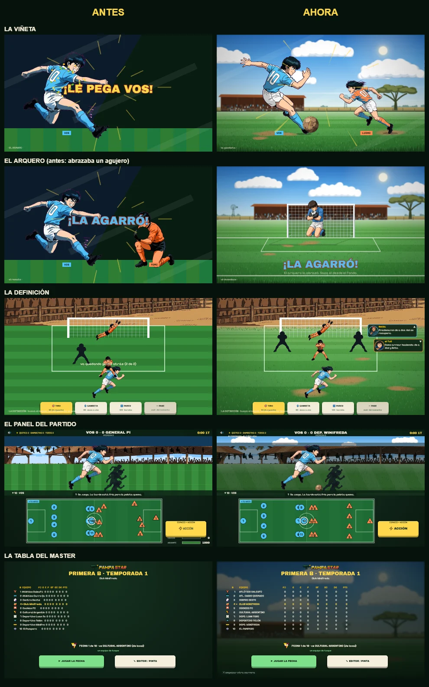
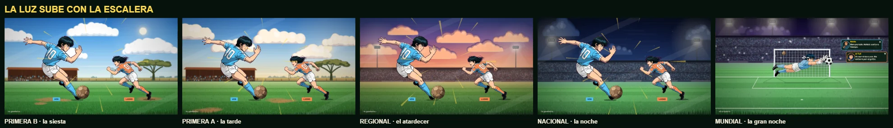

# PAMPA STAR · ARTE V10 · LA LUZ DE LA ESCALERA

Tanda del 24-25 de septiembre de 2026. Pedido de Rodri: **"MEJORAME EL ARTE DEL JUEGO"**.

Las poses son anime ochentoso de verdad: cel con línea de tinta y sombra en dos
tonos. El problema no eran ellas: era todo lo que las rodeaba. Estaban paradas
sobre dos triángulos planos, una franja verde y un rectángulo azul. El dibujo
premium flotaba sobre una pantalla de prueba.

---

## Lo que cambió, en orden

| commit | qué |
|---|---|
| `d6c88ae` | **Sección 11** · el fondo del menú del clásico tenía el logo y las tres tiras de una marca deportiva. Se reemplazó por su franja central (un recorte, no un reproceso). |
| `6b443e7` | **Sección 11** · los cuatro retratos rivales del banco tenían marcas deportivas. Salen del manifiesto y del deploy. El test de Sección 11 ahora vigila también marcas de indumentaria. |
| `8b17d89` | **LA PELOTA ERA INVISIBLE** en todas las escenas desde el 19 de agosto. |
| `d4590b2` | **Los fondos del cine se pintan**, y la luz sube con la escalera. |
| `4f06b14` | **El panel del partido** con la luz de la división. |
| `1d973e5` | **El Master pasa en tu cancha**: tabla, semana y eventos. |
| `052a9d0` | La opción elegida del evento pisaba la tira de los días. |

### La pelota invisible

`pelotaVieja()` cambiaba la pelota de gajos por la de potrero pasándola por una
renderTexture y registrando `"ball"` con la fuente de esa renderTexture. En
WebGL esa fuente es la textura de la GPU, no una imagen: la `"ball"` nueva
quedaba **vacía**. Cinco semanas sin pelota en ninguna escena del cine. Como
las poses tienen un hueco donde se recortó la pelota dibujada, **el arquero
abrazaba un agujero negro** — está en `A5_atajada_arreglada.png`, del 19 de
agosto, y nadie lo leyó como bug. Apareció porque la chilena pateaba el aire.

Ahora se rasteriza en un canvas 2D, más una versión de 128 px para los planos
de cerca. Guardián: `phaser/test/pelota_visible.test.js` (con el código viejo
da 6 fallas).

### Los fondos pintados

Todo por código, Canvas 2D, en `phaser/scenes/cine_arte.js`. Se pinta una vez
por partido (12 a 35 ms) y queda como textura. Como en el anime de los 80: el
cel adelante, nítido; atrás, la pintura —cielo en degradé con pinceladas,
nubes de tres tonos con la base plana, el horizonte pampeano (monte, campo,
molino, caldén, tribuna de chapa, alambrado) o el estadio con torres de luz, y
el pasto con las franjas de corte en perspectiva, peladas de tierra y matas
adelante—. Lo lejano va apenas desenfocado.

Once lugares que pintaban plano ahora piden su pintura, y todos conservan el
fondo viejo como respaldo si la pintura no está:

- la viñeta (`escenaCine`), el golpe de lo especial y el anuncio de megacosa
  (degradé radial, líneas de foco, trama de puntos en las esquinas);
- los cinco planos del remate (el pie, el viaje, el esfuerzo, el arquero, el
  desenlace);
- la cancha de las escenas V9 (te rematan, el pase) y la Definición.

Detalles que suman: sombra de contacto bajo los **pies** de cada pose (medidos
una vez por textura), líneas de velocidad en cuña, palos del arco con volumen,
defensores en silueta parados en el pasto y no flotando en el cielo.

### La luz de la escalera

`data/ambientes.json`: Primera B = la siesta del domingo · Primera A = la tarde ·
Regional = el atardecer · Nacional = la noche con torres · Mundial = la gran
noche. Subir de división se VE — en el cine, en el panel del partido y en los
menús del Master.

**La luz es ambiente, nunca información** (Rodri es daltónico): quién
protagoniza cada jugada lo dicen las placas con nombre y la palabra VOS. El
test `arte_cine.test.js [6]` lo vigila.

---

## DECISIONES QUE TOMÉ YO

**1 · El fondo del menú del clásico: recortado, no reprocesado.** Elegí la
franja central (x 190-622 de 1024) porque saca la marca entera y queda
vertical, que calza con la caja del menú. No toqué un pixel.
*Se revierte:* `git checkout ac2a2e9 -- assets/ui/fondo_menu.webp` (vuelve la marca).

**2 · Los cuatro retratos rivales, afuera.** Con el grupo vacío el juego cae a
la cara del avatar, que es lo que ya se veía con el flag de retratos modulares
prendido. En pantalla hoy no cambia nada.
*Se revierte:* solo con arte repintado sin marcas (nota `_seccion11` del manifiesto).

**3 · Los fondos los pinta el código.** Contradice la letra del GDD §10.1
("Rodri pone los dibujos"), no su espíritu: el techo bajo es de los
personajes, y acá ningún personaje se dibuja por código. Lo dejé escrito en el
GDD como ajuste.
*Se revierte:* sacando la línea de `pAmbientes` en `phaser/index.html` — sin
paletas, cada plano dibuja su fondo viejo.

**4 · Qué hora le toca a cada división.** La siesta abajo y la noche arriba
porque la escalera va del pueblo al mundo, y los partidos grandes se juegan de
noche.
*Se revierte:* `por_division` en `data/ambientes.json`.

**5 · En los estadios, sin la tribuna del pueblo.** La ilustración de la
tribuna de chapa es la cancha del pueblo: en el Mundial al lado de una viñeta
de estadio era otro lugar. Donde no se juega en el pueblo se pintan las gradas.
En el pueblo, la ilustración se tiñe a la hora del partido.
*Se revierte:* `ambienteEsPueblo()` en `cine_arte.js` devolviendo siempre true.

**6 · El acento del rival en la viñeta.** Cuando el rival protagoniza, la
pintura se entibia apenas (tinte `0xffe4d4`, ningún canal por debajo de c0).
Reemplaza la banda diagonal oscura de antes. Es acento, no código.
*Se revierte:* `tinte: rivProta ? 0xffe4d4 : null` → `null` en `escenaCine`.

**7 · La pelota de cerca, en alta.** 16 px sigue siendo la base de todo el
juego (nadie cambió un `setScale`); la de 128 solo entra donde la pelota mide
más de 40 px en pantalla.

**8 · El velo de foco del panel, extendido.** Arrancaba en y=60, a mitad del
cielo: con el cielo pintado se veía el corte. Ahora cubre el panel entero.

**9 · La opción del evento, en el renglón del titular.** Solo si entra a lo
ancho y el titular es de un renglón; si no, queda donde estaba.

**10 · "puma" fuera de la lista de marcas del test.** En La Pampa es un animal.

**11 · Los nombres nuevos de los clubes y de la liga.** Elegí, entre los
candidatos verificados, los más cortos y con el tono de los apodos del roster
(paisaje, flora, viento, oficios). Mantuve el ORDEN y la FUERZA (`f`) de cada
club, así el campeonato juega igual. Corregí dos localidades que estaban mal
("Cochico" no es una localidad: el club era de Victorica; y el club de Telén
no podía estar en Telén dos veces).
*Se revierte:* `data/divisiones.json` y `CLUBES` en `index.html` — nunca a
nombres reales (el test de Sección 11 lo impide).

**12 · Tu club del Master se llama con el apodo de tu localidad.** El diseño
ya definía los clubes por su apodo (GDD §9.2). Los diez se verificaron.
*Se revierte:* `nombreDeTuClub` en `phaser/logic/master.js`.

**13 · La radio queda sin nombre propio** ("la FM del pueblo"). Cualquier nombre
inventado habría que verificarlo, y el cupo de búsquedas se agotó.

**14 · Borrar las rayas al vestir a tus defensores.** La camiseta a rayas es la
marca del rival para quien no distingue colores. Queda celeste lisa.
*Se revierte:* sacar `kit: "rival"` de bloqueo y barrida en el manifiesto de poses.

**15 · Los retratos rotos del grupo compañero, fuera del grupo.** No se veían
con el flag por defecto; con el flag apagado salían rotos y todos iguales.
*Se revierte:* volver a listarlos en `data/portraits_manifest.json`.

**16 · El anillo violeta se limpia en memoria, no en los archivos.** Por tu regla
de no reprocesar. Cuesta ~1 s de trabajo repartido entre cuadros al cargar.
*Se revierte:* sacar el `postBoot` de `phaser/index.html`.

---

## SEGUNDA VUELTA · "hacé lo que me mandás a mí"

La primera versión de este documento terminaba con una lista PARA RODRI.
Rodri contestó que la hiciera yo. Esto es lo que salió:

| commit | qué |
|---|---|
| `1a4c419` | **Tu equipo con tu camiseta.** Te había dicho que el bloqueo y la barrida no se podían teñir (la piel es casi del mismo naranja que la camiseta). Con más trabajo sí: `logic/vestir.js` separa la tela de la piel por las regiones que cierra la tinta, la tonalidad y el contacto, y **borra las rayas** (en el GDD son la marca no-cromática del rival). Tus defensores salen de celeste liso. De paso: tu arquero volaba con la pose genérica naranja, y el rival que te remata en la Definición salía de celeste. |
| `6ab1cdd` | **relatores.webp** recortado a las tres caras con auriculares: sin el escote. |
| `f611de7` | Los siete retratos del grupo compañero, con el alfa roto, salen del grupo (cada jugador cae a su cara de avatar, que es lo que ya se veía). |
| `2b6fe56` | **El anillo violeta del recorte**, que tenían 26 de 51 ilustraciones, se limpia en memoria al cargar (`logic/halo.js`). Los archivos no se tocan. |
| `f5db774` | **FM El Caldén** (hay tres radios reales con ese nombre) pasa a "la FM del pueblo"; dos marcas en textos del clásico ("Reflex", "tuppers") y dos **"Guts" visibles** que se habían escapado. |
| (este) | **Los clubes y la liga reales.** Ver abajo. |

### Los clubes reales

Un relevamiento con búsqueda web confirmó que la Primera B eran los nueve
clubes **reales** de la liga cultural pampeana, con sus colores reales; que
"Alvear Fútbol" (Primera A) es un club real y "Ferrocarril de Castex" se lee
como los Ferro reales; que en el Regional "Patagonia Austral" es un club real,
"Puntano de San Luis" casi, y "Litoral Norte" es un torneo real de la AFA; que
en el Nacional "Comarca Andina" es una liga real; y que "Club " + localidad
(tu club del Master) es como la gente nombra a clubes reales de varias
localidades.

| antes (real) | ahora (ficticio) |
|---|---|
| la Liga Cultural | **la Liga de la Llanura** |
| los 9 de la Primera B | **Jagüel Viejo · Espejo de Sal · Viento Oeste · Rescoldo FC · Guanaco Bravo · Alpataco FC · Cardo Ruso FC · Cauce Viejo · Tolvanera FC**, con colores nuevos |
| Alvear Fútbol · Ferrocarril de Castex | **Surco Hondo · Durmiente FC** |
| Patagonia Austral · Puntano de San Luis · Litoral Norte | **Ñire Torcido · Quebrada Seca · Yerbal Rojo** |
| Comarca Andina | **Mallín Alto** |
| "Club " + localidad | **el apodo de tu localidad** ("El Bagual de Winifreda") |

**Cómo se verificó cada nombre nuevo:** los de la Primera B y la liga, con dos
búsquedas web independientes (quien los propuso y un escéptico que intentó
refutarlos: el escéptico tumbó "Liga del Caldenal", que existe). Los otros
seis, leyendo las listas de clubes de las ligas de cada región en Wikipedia,
porque se agotó el cupo de búsquedas web de la sesión. Los diez apodos, contra
los clubes y apodos reales de cada localidad.

**Las partidas guardadas no se rompen.** En el clásico, el único nombre que se
guarda es el de tu club (todo lo demás va por índice): se traduce por el HASH
del nombre viejo, así el código no tiene escrito ningún nombre real. En el
Master, la temporada en curso se traduce por POSICIÓN (la tabla guarda el
orden de la división). Visto en el juego con partidas viejas armadas a mano:
mismos puntos, misma fecha, ningún nombre real. Test: `migracion_nombres.test.js`.

**La red:** `seccion11.test.js` tiene ahora la lista de clubes, ligas y medios
reales que no pueden volver, más las marcas de texto y "Guts" en cualquier forma.

## PARA RODRI (lo que queda)

- **Estilos que no pegan** (`pose_festejo`, `pose_cansado`, `retrato_juvenil`;
  pelo castaño en `pose_tiro` y `pose_volea`): hace falta arte nuevo, no hay
  arreglo por código. Detalle en `docs/P11_PEDIDOS_DE_ARTE.md`.
- **Mirá los nombres nuevos de los clubes.** Los elegí yo (con el tono de los
  apodos del roster) y están verificados, pero son la cara de la liga: si
  alguno no te gusta, se cambia en `data/divisiones.json` y en `CLUBES` del
  clásico, en el mismo orden, y la migración sigue funcionando.

---

## Cómo se verificó

- **Barrida visual de Sección 11**: las 89 imágenes que se publican (poses,
  caras, identidades, retratos, interfaz), un agente por lote y un segundo
  agente por cada imagen marcada, que tenía que confirmar o descartar. 6
  violaciones confirmadas, 4 marcas descartadas con razones. Las `_fuente` son
  los mismos dibujos en PNG original y no se barrieron aparte.
- **Laboratorio**: `.claude/lab_arte.html` pinta con el mismo pintor del juego
  y compone encima las poses reales en las posiciones de `match.js`.
- **En el juego**: cada plano en las cinco luces, capturado del canvas real
  (`.claude/shots/JUEGO_*`, `PANEL_*`, `MASTER_*`).
- **Suite**: 59 verdes. Nuevos: `arte_cine.test.js` (140 asserts),
  `pelota_visible.test.js`.
